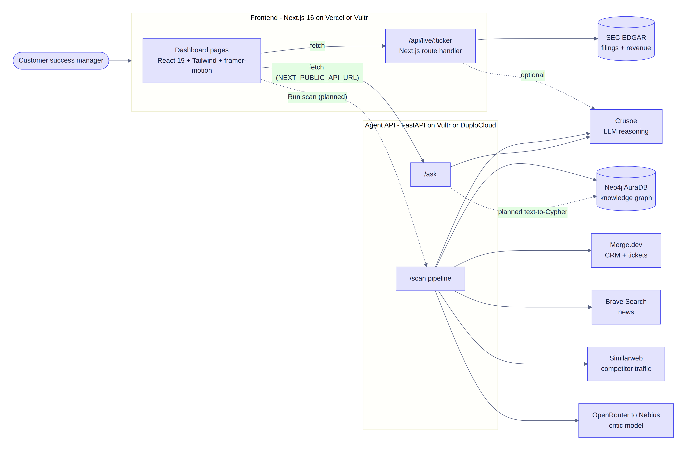

# AccountPulse

- **What it is:** an AI early-warning system that tells customer-success teams which customers are about to leave, why, and what to send them.
- **How:** CRM data + live news + competitor traffic → scored by Crusoe → fact-checked by Nebius → stored as a Neo4j graph → shown in the dashboard.

## Live demo in 3 terminals

- **1. Backend:** `cd backend && source .venv/bin/activate && uvicorn app:app --reload --port 8000`
- **2. Web app:** `cd frontend && npm install && npm run dev` → open http://localhost:3000/dashboard
- **3. MCP server (optional):** `cd mcp && source .venv/bin/activate && python accountpulse_mcp.py --http`
- **Keys:** fill `KEYS.env`, then run `cd backend && python check_keys.py`; everything you'll demo should show PASS.
- **Live mode:** `MOCK=false` in `KEYS.env`; the web app needs `frontend/.env.local` with `NEXT_PUBLIC_API_URL=http://localhost:8000`.
- **Proof on screen:** Overview shows the **Live · scanned [time]** badge; the backend terminal prints `[LLM] provider=crusoe:...`.

## Demo click path (2 minutes)

- **Overview:** revenue at risk, "Call first" account, live signals with real news links.
- **Run scan (top right):** fresh scan across Brave, Similarweb, Crusoe, Nebius and Neo4j (~30 s).
- **Account page:** why the score, evidence with sources, "Scored by Crusoe · checked by Nebius", draft email.
- **Live check:** type a ticker (CHGG, NKE) for a real SEC-filings risk check.
- **Ask AI:** "Who should I call today?" answered by Crusoe from the live scan.
- **Relationship map + Neo4j console:** the graph the scan writes.
- **MCP:** ask Claude Desktop/Code "Who should I call today?" and it calls AccountPulse tools.

## What's live vs sample

- **Live:** Crusoe scoring, Nebius fact-check, Brave news (or free Google News), Similarweb traffic, Neo4j graph, SEC Live check.
- **Sample until Merge.dev is connected:** the customer list (Chegg, Nike, Snowflake), their contract values and ticket counts.
- **Still demo data:** Signals, Competitors, Relationship map, Rescue actions and Daily briefing pages.
- **Not built yet:** login, database, billing, scheduled scans. See [docs/ROADMAP.md](docs/ROADMAP.md).

## Sponsors used

- **Crusoe:** main AI model (`openai/gpt-oss-120b`) for scores, reasons, next steps and answers.
- **OpenRouter → Nebius:** second model (`z-ai/glm-5.1`) that fact-checks and can veto each verdict.
- **Brave:** news about each customer; falls back to free Google News RSS without a key.
- **Similarweb:** competitor website-traffic change over 90 days.
- **Neo4j AuraDB:** Account → Signal → Competitor knowledge graph.
- **Merge.dev:** customer accounts and tickets from any CRM (ready, needs an account token).
- **DuploCloud:** skill + MCP config included (optional, not in live demo).
- **Vultr / UserTesting:** hosting and user feedback (optional).

## Project layout

- `backend/`: FastAPI agent API (`/accounts`, `/scan`, `/ask`, `/health`) and `check_keys.py`.
- `frontend/`: Next.js 16 dashboard (clay + glass design), live data via `components/LiveData.tsx`.
- `mcp/`: MCP server + test client for Claude and DuploCloud ([mcp/README.md](mcp/README.md)).
- `duplocloud/`: ready-made DuploCloud skill (`accountpulse-triage/SKILL.md`).
- `docs/`: product, architecture diagrams, setup, API, roadmap, business, hackathon, DuploCloud guides.
- `KEYS.env`: every key and setting in one file (private, git-ignored).

## Docs

- [docs/PRODUCT.md](docs/PRODUCT.md): problem, users, features, libraries used.
- [docs/ARCHITECTURE.md](docs/ARCHITECTURE.md): system diagram and sequence diagrams.
- [docs/SETUP.md](docs/SETUP.md): install, keys in setup order, troubleshooting.
- [docs/API.md](docs/API.md): endpoints with examples.
- [docs/DUPLOCLOUD.md](docs/DUPLOCLOUD.md): DevKit install and the AccountPulse agent.
- [docs/HACKATHON.md](docs/HACKATHON.md): judging rules, demo script, stage fallbacks.
- [docs/BUSINESS.md](docs/BUSINESS.md) and [docs/ROADMAP.md](docs/ROADMAP.md): market, pricing, launch plan.
