# Architecture and sequence diagrams

Each diagram below is shown twice: as an image (works anywhere) and as Mermaid source (GitHub
renders it; edit the matching file in `diagrams/`). **Live** means it runs today; **planned**
means the design for the next step.

## 1. System overview


- **Frontend** (Next.js) serves the dashboard and one server route, `/api/live/[ticker]`,
  which reads SEC EDGAR directly. Keys used there never reach the browser.
- **Agent API** (FastAPI) runs the multi-source risk pipeline and answers questions.
- **Data and AI services** are called only from servers, never from the browser.

<details><summary>Mermaid source</summary>

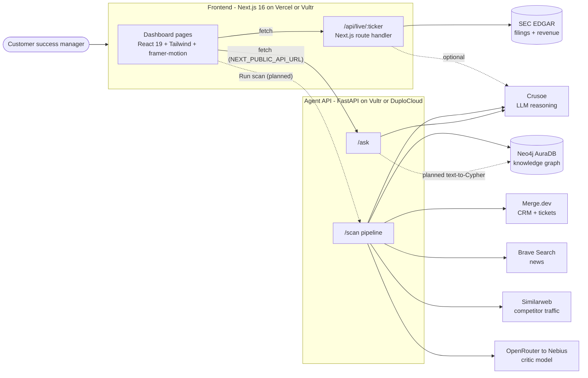
</details>

## 2. Live check with real SEC data (live)

A user checks any U.S. public company. This flow runs today with real data and no API key.

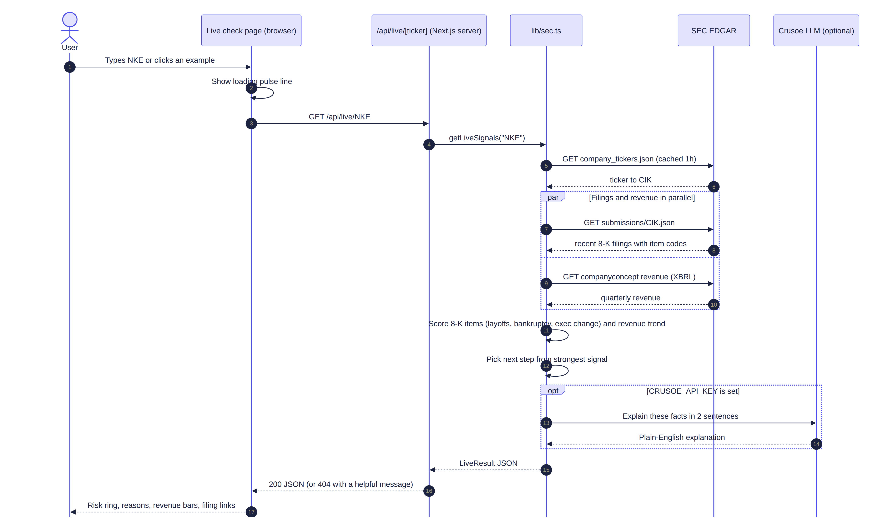

Key points:

- Filings and revenue are fetched in parallel, and every SEC response is cached for one hour
  (SEC allows up to 10 requests per second and asks for a contact email in the User-Agent).
- The score is rule-based and explainable: each 8-K event type adds a fixed weight, recent events
  count more, and each type counts once. Crusoe only rephrases the facts; it never invents them.
- Unknown tickers return a 404 with a message the page shows as-is.

<details><summary>Mermaid source</summary>

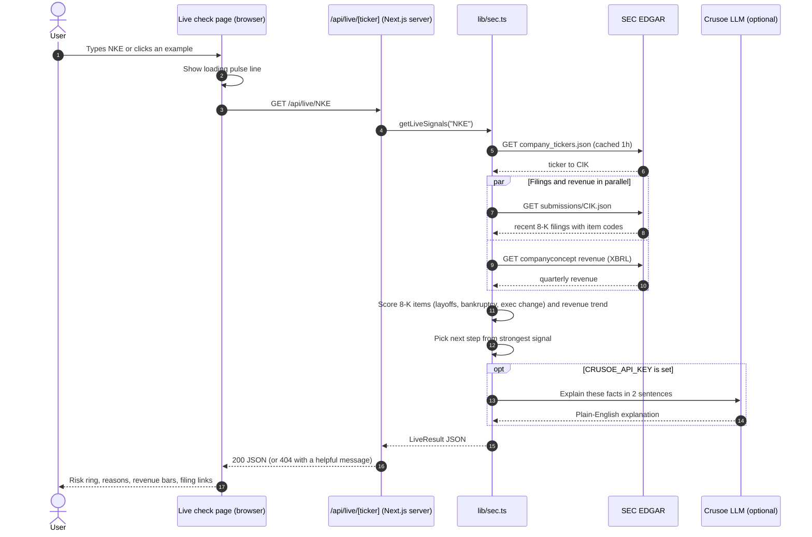
</details>

## 3. Daily risk scan (live in mock mode; planned: scheduled + wired to the button)

The core AccountPulse pipeline, one pass per account.

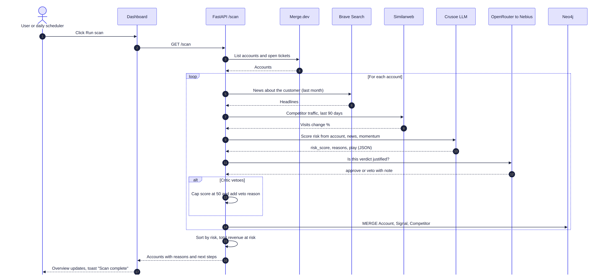

Key points:

- Every external call has a mock fallback, so the pipeline always completes.
- The critic model is a separate provider (OpenRouter routed to Nebius). If it vetoes a verdict,
  the score is capped at 50 and the veto reason is shown to the user.
- News text is passed to the model as data with an explicit instruction not to follow it, to
  limit prompt injection from outside content.

<details><summary>Mermaid source</summary>

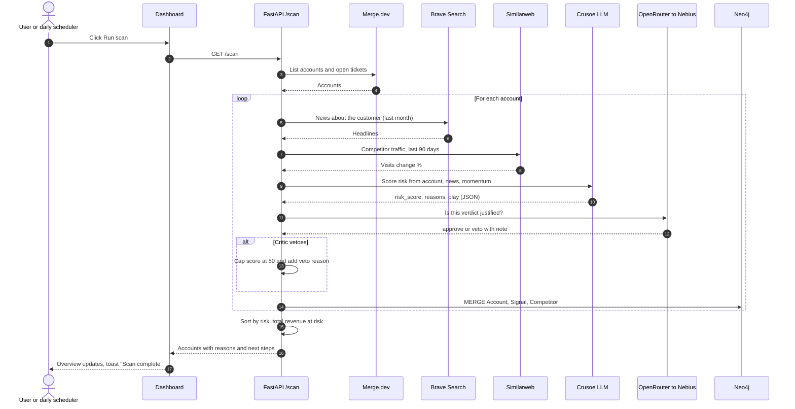
</details>

## 4. Ask AI (live with demo fallback; planned: text-to-Cypher)

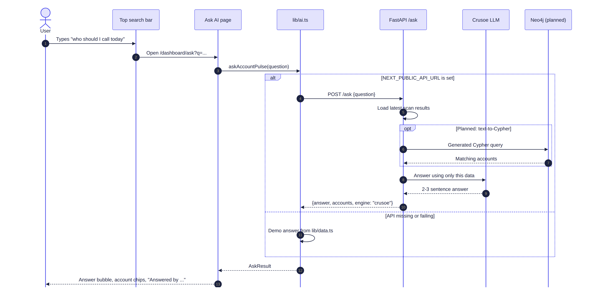

Key points:

- The chat never breaks: if the API is unset or fails, `lib/ai.ts` answers from demo data.
- Every answer says what produced it ("Answered by Crusoe" or "demo data").
- Planned: the API turns the question into a Neo4j Cypher query, so answers come from the graph
  rather than from the model's memory.

<details><summary>Mermaid source</summary>

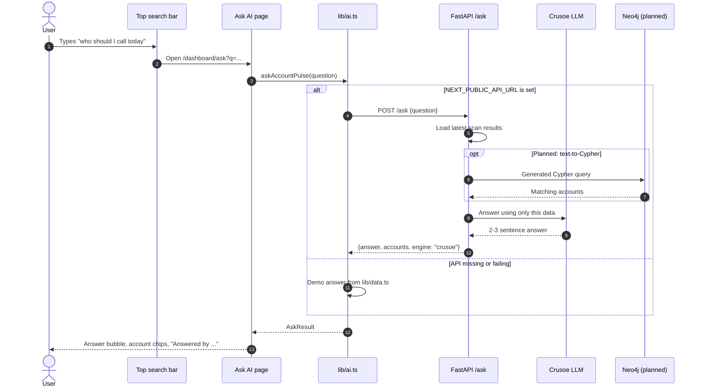
</details>

## 5. Rescue email draft (live with a template; planned: Crusoe-written)

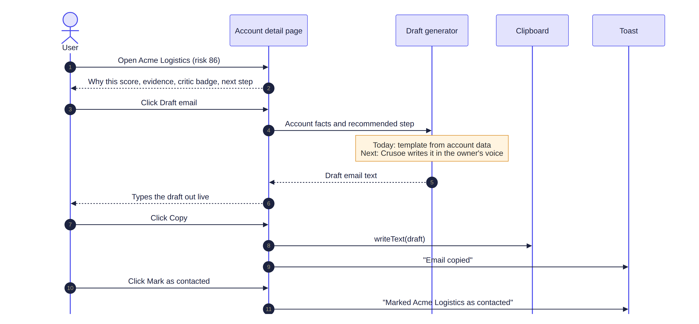

<details><summary>Mermaid source</summary>

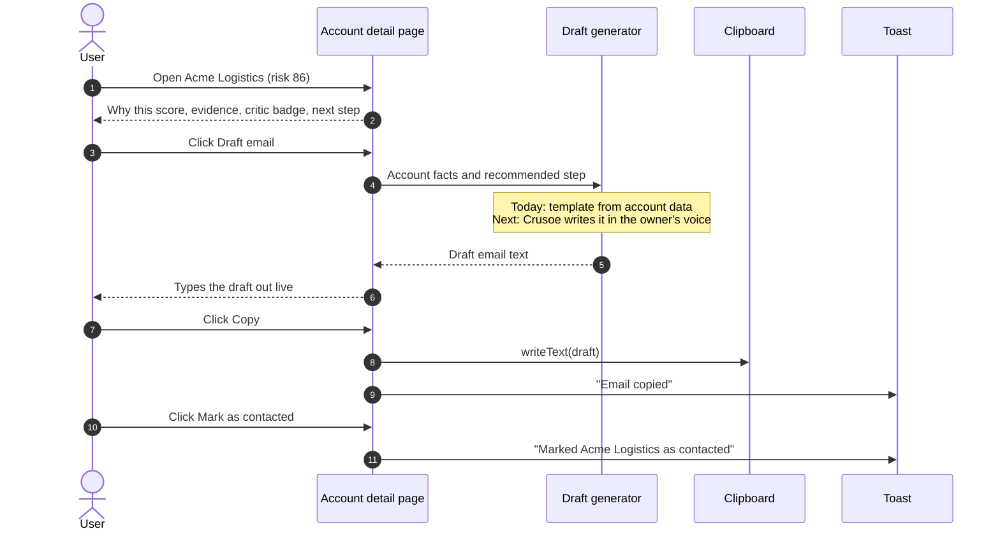
</details>

## 6. Front-end agent workflow (live)

How new pages get built without breaking approved ones.

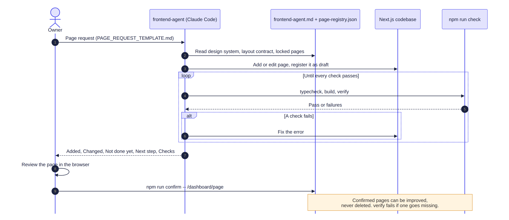

<details><summary>Mermaid source</summary>

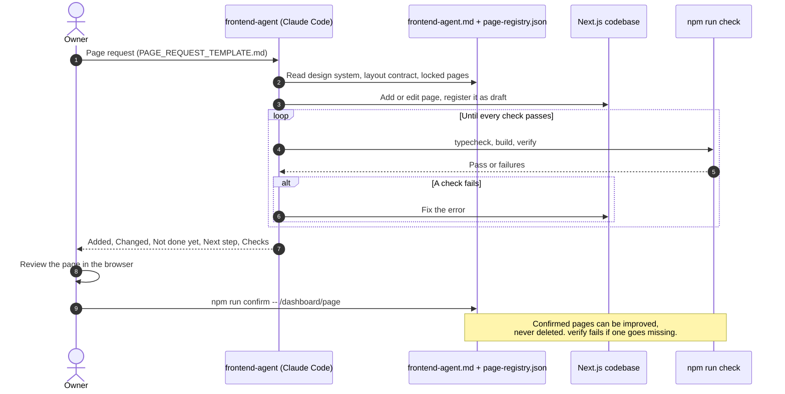
</details>

## Data model

Types live in `frontend/lib/data.ts` (web app) and `frontend/lib/sec.ts` (Live check).

| Entity | Key fields |
|---|---|
| Account | id, name, domain, industry, arr, renewalDate, risk (0-100), trend[8 weeks], owner, openTickets, competitor, why, evidence[], play, criticVerified |
| Evidence | label, detail, source (Merge.dev, Brave, Similarweb, Crusoe, Nebius critic, Neo4j, SEC EDGAR), url |
| Signal | id, accountId, title, source, when, severity (high/medium/low) |
| Competitor | name, domain, visitsChange %, accountsExposed, headline |
| RescueAction | id, accountId, type (Email/Call/Offer), title, draft, status (Draft/Sent/Done) |
| LiveResult | company, risk, reasons[], play, why, whyEngine, revenue{quarters, yoyChange}, events[] |

Neo4j graph (written by `/scan`):

```
(:Account {name, arr, risk, play})-[:HAS_SIGNAL]->(:Signal {text})
(:Account)-[:AT_RISK_FROM]->(:Competitor {domain, momentum})
```

## Security notes

- API keys live only in server-side `.env` files; the browser only ever sees
  `NEXT_PUBLIC_API_URL`.
- The agent API only accepts browser calls from origins listed in `ALLOWED_ORIGINS`.
- Not yet built (see [ROADMAP.md](ROADMAP.md)): login, per-customer data separation, encrypted
  storage, audit logs.
